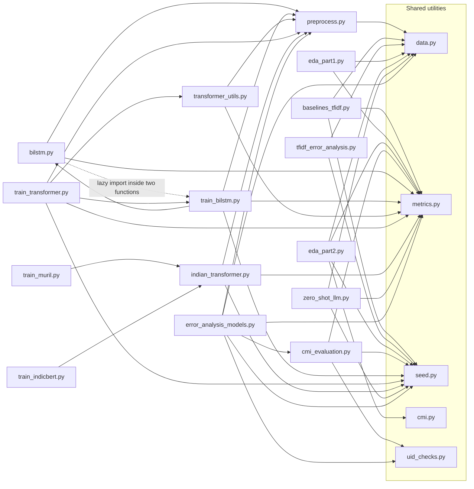
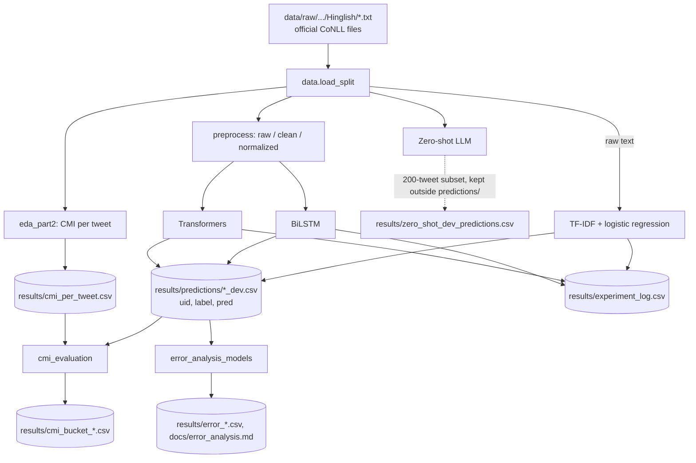

# Architecture

How the code of this project fits together. Everything here was checked against the repository on `main`; where something could not be determined from the code it is listed under "Open questions".

## 1. What kind of system this is

An **offline experiment pipeline** for sentiment classification of Hinglish tweets (SemEval-2020 Task 9). It is a set of Python scripts that are run once from the repository root with `python -m src.<module>`. They read the data files in `data/`, train or evaluate models, and write files into `results/` and `docs/`.

There is **no web server, no API, no database, no authentication and no background job** in this project. The only configuration is a handful of JSON files in `configs/`; the only environment variable the code sets is `PYTHONHASHSEED` (in `src/seed.py`). `src/zero_shot_llm.py` can also read an optional API key from an environment variable (never from a file in the repository) for its hosted-API backend, which has not been run. Sections of a typical software architecture document about those topics do not apply here.

## 2. Components

| Layer | Modules | Responsibility |
|---|---|---|
| Data access | `src/data.py` | Parses the official CoNLL files into one DataFrame row per tweet (`load_split`). Every module gets its tweets from here. |
| Shared utilities | `src/metrics.py`, `src/seed.py`, `src/cmi.py`, `src/uid_checks.py` | The official score (weighted F1) and the confusion matrix; one place to fix randomness; the Code-Mixing Index of one tweet; the guard that makes uid merges safe. |
| Preprocessing | `src/preprocess.py`, `configs/hinglish_variants.json` | Three text versions: `raw`, `clean` (URLs/mentions replaced, noise removed) and `normalized` (clean plus repeated letters and a spelling-variant dictionary). |
| Baseline model | `src/baselines_tfidf.py` | TF-IDF features + logistic regression, and the "always neutral" floor. Uses the raw text from `src/data.py`. |
| BiLSTM | `src/bilstm.py`, `src/train_bilstm.py`, `configs/bilstm_default.json` | Word + character BiLSTM: model, text encoding, checkpoints (`bilstm.py`) and training/evaluation/logging (`train_bilstm.py`). |
| Transformers | `src/transformer_utils.py`, `src/train_transformer.py`, `configs/transformer_config.json`, `src/indian_transformer.py`, `src/train_muril.py`, `src/train_indicbert.py` | Fine-tuning of Hugging Face encoders (mBERT, XLM-R, MuRIL, IndicBERT). |
| LLM | `src/zero_shot_llm.py` | Zero-shot prompting; predictions are scored on a random subset of the dev set. |
| Analysis | `src/eda_part1.py`, `src/eda_part2.py`, `src/cmi_evaluation.py`, `src/tfidf_error_analysis.py`, `src/error_analysis_models.py` | Descriptive statistics, CMI per tweet, scores per CMI bucket with bootstrap intervals, error analysis. |
| Tests | `tests/` | One test file per module group; synthetic data wherever possible. |

## 3. Module dependencies

Generated from the `import` statements of `src/*.py` (an arrow means "imports"):



Notes:
- `src/bilstm.py` and `src/train_bilstm.py` need each other. `bilstm.py` imports `train_bilstm` lazily inside two functions (with a comment saying why), so importing either module works.
- `src/train_transformer.py` reuses output-protection helpers from `src/train_bilstm.py` (`LOG_NAME`, `_parse_set`, `_publish`, `_stamp`, `log_has_run`).
- Nothing imports the two EDA scripts; they are run directly.

## 4. Data flow



Reading the diagram:
1. **Input:** the official files are read only by `src/data.py`. Test labels come from a separate file and are joined by uid.
2. **Text versions:** the TF-IDF baseline uses the raw text; the BiLSTM and the transformers read the version chosen with a `mode` argument through `src/preprocess.py`.
3. **Common output:** every dev model writes `results/predictions/<name>_dev.csv` with the columns `uid,label,pred`. This file format is the contract between models and analyses.
4. **Analyses** read those files (never the models), so any new model that writes the same file is picked up by `python -m src.cmi_evaluation` automatically.
5. **Logging:** training scripts append one row per run to `results/experiment_log.csv` (columns: date, who, model, data_version, settings, seed, dev_score, notes, lesson_learned).

## 5. Rules that every part follows

- **Leakage:** vocabularies, IDF weights and length limits are fitted on the training split only; settings are chosen on dev; the test split is used once, at the end, under a written protocol (`docs/bilstm_final_evaluation_protocol.md`). Descriptive access to the test split (counts, CMI) is disclosed there.
- **One metric implementation:** `src/metrics.py`. The official score is **weighted F1**.
- **Joins by uid, never by row position,** and checked with `src/uid_checks.py` where predictions are merged with other tables.
- **Seeds:** `set_seed` at the start of each script; runs that are averaged use seeds 42, 43 and 44.
- **Outputs are never edited by hand.** Result files are produced by scripts; documents in `docs/` that quote them are written by hand and should be re-checked after a rerun.

## 6. Major design decisions

| Decision | Reason | Where |
|---|---|---|
| Data committed to the repository (Hinglish files only) | The course asks for the data in the repository; the licence (CC-BY 4.0) allows it. | `.gitignore`, `docs/data_format.md` |
| Standard CMI formula, used for ranking only | Our mean (29.8) does not match the paper's 25.3 and no variant reproduced it. | `src/cmi.py`, `docs/eda_part2.md` |
| Bucket edges from train quantiles | Dev/test information must not define the groups. | `src/cmi_evaluation.py`, `docs/cmi_analysis.md` |
| Predictions as files in a common format | Analyses stay independent of the models. | Section 4 |
| Bootstrap intervals, one generator per file | Bucket scores rest on about 1,000 tweets; adding a file must not change others' intervals. | `src/cmi_evaluation.py` |
| Three preprocessing versions | Separates the effect of cleaning from the effect of spelling normalisation. | `docs/preprocessing.md` |

## 7. Directory layout

```
data/raw/…            official Hinglish files (committed)
src/                  all code (run with python -m src.<module>)
tests/                pytest tests
configs/              experiment settings and the spelling-variant dictionary
results/              predictions, scores, logs, figures (written by scripts)
docs/                 explanations, protocols, analyses, this file
reports/              the report text
notebooks/            notebooks (BiLSTM summary, Colab runner)
```

## 8. Open questions

- The exact definition of CMI used by the task organisers is unknown (see `docs/eda_part2.md`).
- `dominant_share` and `md_escape` are implemented in more than one analysis script (`src/eda_part1.py`, `src/eda_part2.py`, `src/tfidf_error_analysis.py`); they could be shared.
- `LANGS` in `src/cmi.py` is not used by any code.
- The scripts that ran the frozen BiLSTM test evaluation were removed from the repository (`docs/bilstm_final_evaluation_protocol.md` explains and points to the git history); other code that imported helpers from them needs its own copies.
- The BiLSTM checkpoints are not in git (git-ignored), so the frozen test evaluation can be inspected through its saved results but not rerun from a clean clone.
