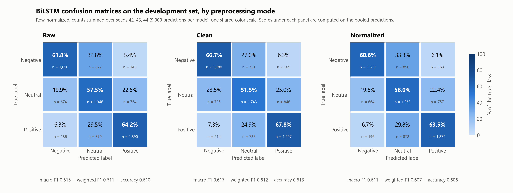
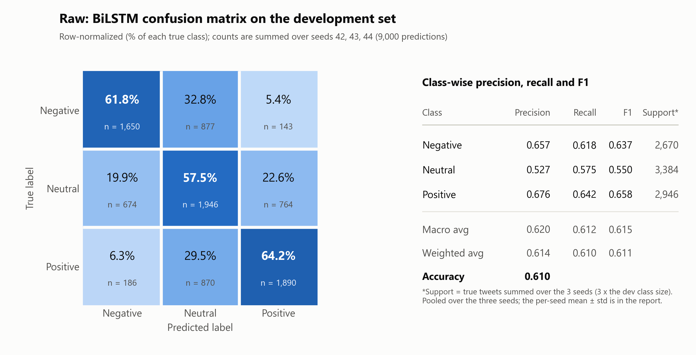
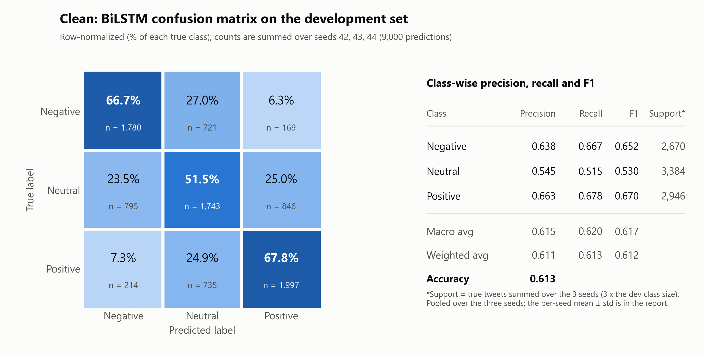
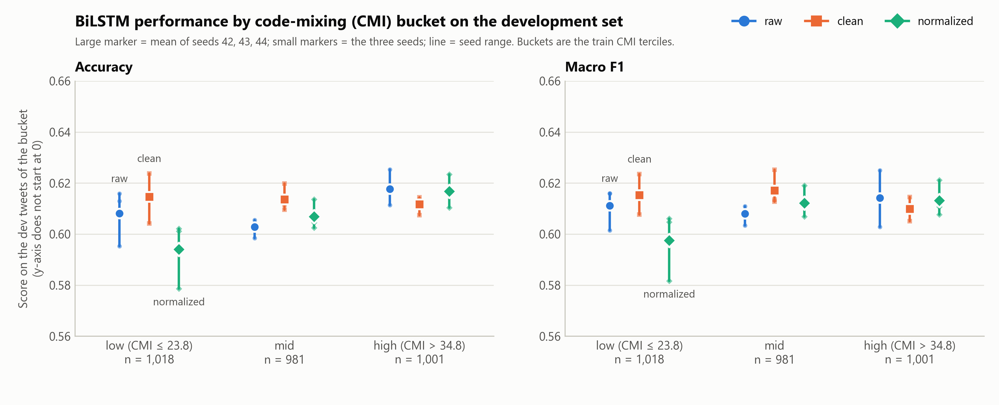

# BiLSTM word + character model: development-set results analysis

*Raw vs clean vs normalized preprocessing, seeds 42 / 43 / 44. Development set only. Generated by `python -m src.analyze_bilstm_results`; every number below is computed from the existing experiment outputs.*

> **Content note.** The quoted tweets come from real social-media data and include political arguments and abusive language.

## Main findings

1. **The three preprocessing modes are not clearly distinguishable on the dev set.** Mean weighted F1 over three seeds: raw 0.6105 (± 0.0041), clean 0.6118 (± 0.0015), normalized 0.6071 (± 0.0007); the spread between modes (0.0047) is comparable to a single mode's seed std and below the dev sampling error. All pairwise bootstrap intervals for the accuracy difference include 0. The most consistent pattern is **normalized below clean in 3 of 3 seeds** (accuracy -0.0076, 95% interval [-0.0163, +0.0016]). Normalization did **not** improve performance; no mode should be called the winner.
2. **Errors are about the neutral boundary.** 90% of errors involve the neutral class; direct negative <-> positive flips are only 10%. Neutral has the lowest F1 in every mode.
3. **Many errors are shared by all runs:** 542 of 3,000 dev tweets (18%) are wrong in all nine runs, 1072 (36%) are right in all nine, and the rest flip between runs.
4. **Spelling normalization has opposite effects by step (exploratory, small subsets):** on tweets the dictionary step changed (n = 383) normalized is +1.9 points vs raw (interval [-1.0, +5.0], includes 0); on tweets the repeated-letter step changed (n = 112) it is -6.0 points ([-11.0, -1.2], excludes 0); and on control tweets with identical text in all modes it still differs by -0.5 points ([-1.5, +0.5]) purely because of different training, which is the scale of difference not to over-interpret (section 5.4).
5. **Code-mixing (CMI buckets): no clear trend within any mode** (high-minus-low intervals include 0). One bucket-level pairwise difference stands out: in the low bucket normalized is -2.1 points vs clean ([-3.7, -0.4]); all three normalized seeds are below all three clean seeds there. With nine comparisons and no correction this is a lead to re-check, not an established effect. Hard tweets are spread almost evenly over the buckets (low 172, mid 176, high 194).
6. **Limits:** three seeds, best epoch selected on dev, heuristic categories, no test evaluation (section 7).

## 1. Scope, sources and restrictions

**Inputs (all pre-existing, read-only):** nine score files `results/bilstm_full_<mode>_s<seed>_dev_scores.json`, nine prediction files `results/predictions/bilstm_full_<mode>_s<seed>_seed<seed>_dev.csv` (`uid,label,pred`), Mani's per-tweet CMI file `results/cmi_per_tweet.csv` (**train and dev rows only**; for its 3,000 test rows only the `split` field was inspected so that they could be skipped, and their labels and CMI values were not parsed or used), `results/eda_part2_stats.json`, `results/tfidf_dev_scores.json`, and the official dev file for tweet text and gold labels.

**Not done:** no model was trained or re-trained; the test split and test labels were not used; preprocessing, model code, hyper-parameters, CMI values and the CMI methodology were not changed; no existing result or prediction file was modified.

**Missing field, handled explicitly:** the score JSONs store accuracy, macro/weighted F1 and per-class precision/recall/F1/support, but **not** macro or weighted precision and recall. These are derived here from the prediction files (and the derivation is checked: recomputed accuracy, F1 and per-class values equal the stored ones to 1e-9, see section 2). Weighted recall equals accuracy by definition.

## 2. Verification of inputs (Task 5)

**28 of 28 checks passed.**

| Result | Check | Detail |
|---|---|---|
| PASS | Official dev file: 3,000 unique uids | 3000 rows |
| PASS | scores JSON metadata (mode, seed, limits 56/18, single seed) (x9 runs) |  |
| PASS | prediction file has columns uid,label,pred; 3,000 unique uids; uid set == official dev; gold labels agree by uid; valid predictions (x9 runs) | row order equals dev file order: True |
| PASS | Metrics recomputed from the nine prediction files equal the stored score JSONs (accuracy, macro F1, weighted F1, per-class precision/recall/F1) | max absolute difference 0.00e+00 |
| PASS | CMI file: test rows skipped (only their split field was inspected; their label and CMI values were not parsed or used) | 3000 rows skipped |
| PASS | CMI dev rows: 3,000, unique uids, uid set == official dev uids (no missing, no duplicate) |  |
| PASS | CMI dev label column equals the official dev gold label (join by uid) |  |
| PASS | CMI values are within [0, 50] |  |
| PASS | CMI train rows: 14,000 |  |
| PASS | Train tercile edges reproduce Mani's recorded bucket sizes and ranges (eda_part2_stats.json) | train bucket sizes [4809, 4576, 4615] vs recorded [4809, 4576, 4615]; edges [0.0, 23.81, 34.783, 50.0] |
| PASS | Every dev tweet falls in exactly one CMI bucket | dev bucket sizes {'high': 1001, 'mid': 981, 'low': 1018} |
| PASS | Confusion matrices recomputed from predictions equal those stored in the score JSONs |  |

All joins between predictions, gold labels, tweet text and CMI values use the **uid**, never row position (the prediction files happen to be in dev-file order, but nothing relies on it).

## 3. Consolidated comparison (Task 1)

### 3.1 Mean ± sample standard deviation across the three seeds

For each seed the metric is computed on the 3,000 dev tweets; the table shows mean ± sample std (n = 3, ddof = 1) of those three per-seed values. **Weighted recall equals accuracy.**

| Mode | Accuracy | Macro precision | Macro recall | **Macro F1** | Weighted precision | **Weighted F1** |
|---|---|---|---|---|---|---|
| raw | 0.6096 ± 0.0048 | 0.6218 ± 0.0052 | 0.6115 ± 0.0096 | **0.6143 ± 0.0056** | 0.6160 ± 0.0033 | **0.6105 ± 0.0041** |
| clean | 0.6133 ± 0.0028 | 0.6160 ± 0.0018 | 0.6199 ± 0.0055 | **0.6172 ± 0.0022** | 0.6119 ± 0.0009 | **0.6118 ± 0.0015** |
| normalized | 0.6058 ± 0.0008 | 0.6182 ± 0.0064 | 0.6070 ± 0.0019 | **0.6105 ± 0.0004** | 0.6126 ± 0.0063 | **0.6071 ± 0.0007** |

### 3.2 Metrics on pooled predictions

Here the three seeds' predictions are **concatenated** (3 x 3,000 = 9,000 predictions per mode) and each metric is computed **once** on the pooled set. This is a different quantity from section 3.1: it has no seed-to-seed spread, and the 9,000 predictions are **not independent** (the same 3,000 tweets appear three times), so it must not be used to compute confidence intervals.

| Mode | Accuracy | Macro precision | Macro recall | Macro F1 | Weighted precision | Weighted F1 |
|---|---|---|---|---|---|---|
| raw | 0.6096 | 0.6200 | 0.6115 | 0.6151 | 0.6143 | 0.6112 |
| clean | 0.6133 | 0.6154 | 0.6199 | 0.6173 | 0.6112 | 0.6120 |
| normalized | 0.6058 | 0.6165 | 0.6070 | 0.6109 | 0.6110 | 0.6075 |

### 3.3 How the two aggregations differ

| Mode | Metric | Mean of per-seed values | Pooled predictions | Pooled - mean |
|---|---|---|---|---|
| raw | Accuracy | 0.6096 | 0.6096 | +0.00000 |
| raw | Macro F1 | 0.6143 | 0.6151 | +0.00073 |
| raw | Weighted F1 | 0.6105 | 0.6112 | +0.00069 |
| clean | Accuracy | 0.6133 | 0.6133 | +0.00000 |
| clean | Macro F1 | 0.6172 | 0.6173 | +0.00019 |
| clean | Weighted F1 | 0.6118 | 0.6120 | +0.00019 |
| normalized | Accuracy | 0.6058 | 0.6058 | -0.00000 |
| normalized | Macro F1 | 0.6105 | 0.6109 | +0.00038 |
| normalized | Weighted F1 | 0.6071 | 0.6075 | +0.00039 |

Accuracy is identical in both ways (every seed has the same number of tweets). F1 is not linear in the predictions, so pooled and averaged F1 differ slightly (here by at most 0.00073). The headline numbers in this report are the **mean of per-seed metrics** (3.1), because they come with a seed spread.

### 3.4 Class-wise precision, recall and F1 (mean ± std over seeds)

| Mode | Class | Dev support | Precision | Recall | F1 |
|---|---|---|---|---|---|
| raw | negative | 890 | 0.6615 ± 0.0349 | 0.6180 ± 0.0818 | 0.6353 ± 0.0309 |
| raw | neutral | 1128 | 0.5280 ± 0.0148 | 0.5751 ± 0.0434 | 0.5495 ± 0.0111 |
| raw | positive | 982 | 0.6758 ± 0.0052 | 0.6415 ± 0.0098 | 0.6582 ± 0.0029 |
| clean | negative | 890 | 0.6394 ± 0.0210 | 0.6667 ± 0.0406 | 0.6519 ± 0.0125 |
| clean | neutral | 1128 | 0.5455 ± 0.0112 | 0.5151 ± 0.0319 | 0.5292 ± 0.0112 |
| clean | positive | 982 | 0.6631 ± 0.0099 | 0.6779 ± 0.0082 | 0.6704 ± 0.0057 |
| normalized | negative | 890 | 0.6535 ± 0.0200 | 0.6056 ± 0.0198 | 0.6283 ± 0.0063 |
| normalized | neutral | 1128 | 0.5265 ± 0.0081 | 0.5801 ± 0.0374 | 0.5515 ± 0.0136 |
| normalized | positive | 982 | 0.6745 ± 0.0415 | 0.6354 ± 0.0619 | 0.6517 ± 0.0191 |

### 3.5 Every run

| Run | Accuracy | Macro P | Macro R | Macro F1 | Weighted P | Weighted F1 | Best / run epochs | Train min |
|---|---|---|---|---|---|---|---|---|
| full_raw_s42 | 0.6040 | 0.6277 | 0.6004 | 0.6078 | 0.6198 | 0.6058 | 9 / 13 | 39 |
| full_raw_s43 | 0.6123 | 0.6192 | 0.6168 | 0.6176 | 0.6145 | 0.6131 | 11 / 15 | 31 |
| full_raw_s44 | 0.6123 | 0.6184 | 0.6174 | 0.6176 | 0.6137 | 0.6127 | 8 / 12 | 21 |
| full_clean_s42 | 0.6160 | 0.6167 | 0.6238 | 0.6195 | 0.6127 | 0.6136 | 10 / 14 | 72 |
| full_clean_s43 | 0.6103 | 0.6174 | 0.6136 | 0.6152 | 0.6120 | 0.6109 | 10 / 14 | 33 |
| full_clean_s44 | 0.6137 | 0.6140 | 0.6223 | 0.6168 | 0.6109 | 0.6109 | 9 / 13 | 17 |
| full_normalized_s42 | 0.6067 | 0.6162 | 0.6082 | 0.6110 | 0.6104 | 0.6074 | 11 / 15 | 26 |
| full_normalized_s43 | 0.6050 | 0.6254 | 0.6049 | 0.6104 | 0.6198 | 0.6075 | 6 / 10 | 25 |
| full_normalized_s44 | 0.6057 | 0.6130 | 0.6081 | 0.6101 | 0.6077 | 0.6063 | 7 / 11 | 13 |

### 3.6 Are the differences between modes larger than the noise?

Two sources of uncertainty, kept apart:

1. **Seed-to-seed variation** (section 3.1 standard deviations; only 3 seeds, so the std itself is rough).
2. **Sampling variation of the 3,000 dev tweets.** A paired bootstrap (4,000 resamples of the dev tweets, fixed seed; the same resample is applied to every mode and seed) gives a 95% interval for the difference between modes of the seed-averaged metric. It reflects which tweets happen to be in the dev set, **not** seed variation.

| Difference | Metric | Mean difference | 95% bootstrap interval (dev sampling) | Interval vs 0 | Per seed (42 / 43 / 44) | Seeds where first mode is higher |
|---|---|---|---|---|---|---|
| clean - raw | Accuracy | +0.0038 | [-0.0060, +0.0137] | includes 0 | +0.0120 / -0.0020 / +0.0013 | 2 of 3 |
| clean - raw | Macro F1 | +0.0028 | [-0.0069, +0.0126] | includes 0 | +0.0117 / -0.0024 / -0.0008 | 1 of 3 |
| normalized - raw | Accuracy | -0.0038 | [-0.0133, +0.0054] | includes 0 | +0.0027 / -0.0073 / -0.0067 | 1 of 3 |
| normalized - raw | Macro F1 | -0.0038 | [-0.0132, +0.0053] | includes 0 | +0.0032 / -0.0072 / -0.0075 | 1 of 3 |
| normalized - clean | Accuracy | -0.0076 | [-0.0163, +0.0016] | includes 0 | -0.0093 / -0.0053 / -0.0080 | 0 of 3 |
| normalized - clean | Macro F1 | -0.0067 | [-0.0153, +0.0024] | includes 0 | -0.0085 / -0.0048 / -0.0066 | 0 of 3 |

**Reading the table.** Every interval includes 0, so no difference between modes is established. The most consistent pattern is that **normalized is lower than clean in 3 of 3 seeds** (accuracy -0.0076, 95% interval [-0.0163, +0.0016]); clean vs raw changes sign between seeds. The differences are of the same size as the seed-to-seed spread of a single mode.

The seeds share the dev set and the split but **not** the random initialisation (the vocabularies, hence the embedding tables, differ between modes), so the per-seed differences are descriptive and not a formal paired test.

### 3.7 Reference: the TF-IDF baselines (existing results, dev set)

| Model | Accuracy | Macro F1 | Weighted F1 |
|---|---|---|---|
| TF-IDF word 1-2 | 0.6120 | 0.6161 | 0.6113 |
| TF-IDF char 2-5 | 0.6123 | 0.6164 | 0.6127 |
| TF-IDF word+char | 0.6107 | 0.6154 | 0.6121 |
| Majority class (neutral) | 0.3760 | - | 0.2055 |

These are single deterministic runs whose regularisation strength was chosen on dev (a mild optimistic bias, as for the BiLSTM's best epoch).

## 4. Confusion matrices (Task 2)

**Aggregation method.** For each mode the three seeds' predictions are pooled, and the matrix is the **sum of the three per-seed 3x3 count matrices** (9,000 predictions; each row sums to 3 x the dev class size). Cells are shown as the percentage of the true class (row-normalised) with the pooled count. The class-wise precision, recall and F1 printed in each figure are computed on the same pooled predictions; section 3.4 gives the per-seed mean ± std. Per-seed matrices are in Appendix A. Figures use one shared color scale (0-100% of the true class).

**Raw** (`results/figures/bilstm_confusion_raw.png`)

|  | pred negative | pred neutral | pred positive | Row total |
|---|---|---|---|---|
| true negative | 1,650 (61.8%) | 877 (32.8%) | 143 (5.4%) | 2,670 |
| true neutral | 674 (19.9%) | 1,946 (57.5%) | 764 (22.6%) | 3,384 |
| true positive | 186 (6.3%) | 870 (29.5%) | 1,890 (64.2%) | 2,946 |

**Clean** (`results/figures/bilstm_confusion_clean.png`)

|  | pred negative | pred neutral | pred positive | Row total |
|---|---|---|---|---|
| true negative | 1,780 (66.7%) | 721 (27.0%) | 169 (6.3%) | 2,670 |
| true neutral | 795 (23.5%) | 1,743 (51.5%) | 846 (25.0%) | 3,384 |
| true positive | 214 (7.3%) | 735 (24.9%) | 1,997 (67.8%) | 2,946 |

**Normalized** (`results/figures/bilstm_confusion_normalized.png`)

|  | pred negative | pred neutral | pred positive | Row total |
|---|---|---|---|---|
| true negative | 1,617 (60.6%) | 890 (33.3%) | 163 (6.1%) | 2,670 |
| true neutral | 664 (19.6%) | 1,963 (58.0%) | 757 (22.4%) | 3,384 |
| true positive | 196 (6.7%) | 878 (29.8%) | 1,872 (63.5%) | 2,946 |

**What the matrices show** (pooled over seeds):

- **raw:** 3,514 of 9,000 predictions are wrong; 91% of the errors involve the neutral class and only 9% are direct negative <-> positive flips. Recall by class: negative 61.8%, neutral 57.5%, positive 64.2%.
- **clean:** 3,480 of 9,000 predictions are wrong; 89% of the errors involve the neutral class and only 11% are direct negative <-> positive flips. Recall by class: negative 66.7%, neutral 51.5%, positive 67.8%.
- **normalized:** 3,548 of 9,000 predictions are wrong; 90% of the errors involve the neutral class and only 10% are direct negative <-> positive flips. Recall by class: negative 60.6%, neutral 58.0%, positive 63.5%.
- **Neutral is the hardest class** in most runs: polar tweets are often read as neutral (about a third of the negative tweets and 25-30% of the positive tweets), and neutral tweets are spread over both polar classes.

## 5. Error analysis (Task 3, BiLSTM-specific and preliminary)

*This is a BiLSTM-specific preliminary analysis. Akansha is responsible for the team's broader categorised error analysis.*

**Method and caveats.**

- Predictions come from the nine real dev prediction files. A tweet is an *error* for a run if its predicted label differs from the gold label.
- Categories are **heuristic and transparent**: negation = the cleaned tweet contains one of `cannot`, `dont`, `mat`, `na`, `naa`, `nahi`, `nahim`, `nahin`, `nai`, `neither`, `never`, `nhi`, `nhin`, `no`, `nope`, `nor`, `not`, `nothing` or a word ending in `n't` (a crude list; `na` and `no` are ambiguous, so this over-counts); spelling variation = the tweet text is changed by the normalization step of `src.preprocess`; code-mixing = the CMI bucket of section 6.
- **Sarcasm, ambiguity and possible label inconsistency cannot be detected automatically.** For these the *tweets* are real and selected by simple rules (e.g. gold negative but positive-sounding words and predicted positive), but the *interpretation* ("reads as sarcastic") is **my reading**, not an annotation, and the gold labels themselves are noisy (the SemEval annotators agreed only 55% of the time, see `docs/problem_statement.md`).
- Every example below is a real dev tweet; its uid, gold label, predictions and CMI are read from the data. The tweet text is the dev file's tokenised text (tokens joined by spaces).

### 5.1 Overall error structure (pooled over seeds)

| Mode | Errors | 1st | 2nd | 3rd | 4th | 5th | 6th |
|---|---|---|---|---|---|---|---|
| raw | 3,514 | negative->neutral: 877 (25%) | positive->neutral: 870 (25%) | neutral->positive: 764 (22%) | neutral->negative: 674 (19%) | positive->negative: 186 (5%) | negative->positive: 143 (4%) |
| clean | 3,480 | neutral->positive: 846 (24%) | neutral->negative: 795 (23%) | positive->neutral: 735 (21%) | negative->neutral: 721 (21%) | positive->negative: 214 (6%) | negative->positive: 169 (5%) |
| normalized | 3,548 | negative->neutral: 890 (25%) | positive->neutral: 878 (25%) | neutral->positive: 757 (21%) | neutral->negative: 664 (19%) | positive->negative: 196 (6%) | negative->positive: 163 (5%) |

Recurring pattern 1: **errors are dominated by the neutral boundary.** Polar tweets read as neutral (negative->neutral, positive->neutral) and neutral tweets read as polar account for about nine of ten errors in every mode, while direct negative <-> positive flips are rare.

### 5.2 Consistently hard vs unstable tweets

Each tweet has 9 predictions (3 modes x 3 seeds).

- **Right in all 9 runs: 1,072 tweets (36%).**
- **Wrong in all 9 runs: 542 tweets (18%)** - gold labels: negative 149, neutral 208, positive 185. These are the tweets no run can get right: hard cases, or cases where the gold label is debatable.
- **Wrong in 1-8 runs: 1,386 tweets (46%)**: the runs disagree with each other, which is a measure of how borderline the sentiment is. Their number of wrong runs: 1: 277, 2: 211, 3: 170, 4: 134, 5: 147, 6: 125, 7: 142, 8: 180.

Recurring pattern 2: **a large share of the errors are shared by all nine runs**, so they are not caused by seed noise or by the choice of preprocessing mode; they reflect genuinely hard tweets, limits of this model, or debatable gold labels (this analysis cannot tell which). A further large group flips between runs.

### 5.3 Accuracy by tweet property

Accuracy averaged over the three seeds of each mode (n = number of dev tweets). Gold-label mixes differ between subsets, so differences are descriptive.

| Subset | n | raw | clean | normalized |
|---|---|---|---|---|
| All dev tweets | 3,000 | 0.6096 | 0.6133 | 0.6058 |
| Contains a negation token | 1,026 | 0.5604 | 0.5669 | 0.5608 |
| No negation token | 1,974 | 0.6351 | 0.6375 | 0.6292 |
| Text changed by normalization | 479 | 0.6006 | 0.5999 | 0.6019 |
| Text not changed by normalization | 2,521 | 0.6113 | 0.6159 | 0.6065 |
| Tweet cut off (ends with ...) | 283 | 0.6219 | 0.6278 | 0.6090 |
| CMI low | 1,018 | 0.6081 | 0.6146 | 0.5940 |
| CMI mid | 981 | 0.6028 | 0.6137 | 0.6069 |
| CMI high | 1,001 | 0.6177 | 0.6117 | 0.6167 |

Recurring pattern 3: **tweets with a negation token are harder** (about 7.1 accuracy points lower than tweets without one, on average over the modes). Part of this gap may come from the different label mix of these tweets (negation tweets: negative 432, neutral 414, positive 180), so it is not proof that negation is mishandled by itself.

### 5.4 Spelling variation: does normalization help where it changes the text?

Normalization changes the text of some dev tweets in two ways: the **repeated-letter** step (`yaaar` -> `yaar`) and the **Hinglish-dictionary** step (`nhi` -> `nahi`). Tweets whose text is identical in all three modes act as a control. Accuracy is averaged over seeds; the bootstrap interval is for *normalized minus raw* on that subset (tweet sampling only).

| Subset | n | raw | clean | normalized | normalized - raw | 95% interval |
|---|---|---|---|---|---|---|
| Hinglish-dictionary step changed the text | 383 | 0.5701 | 0.5762 | 0.5892 | +0.0191 | [-0.0096, +0.0496] |
| Repeated-letter step changed the text | 112 | 0.6964 | 0.6756 | 0.6369 | -0.0595 | [-0.1101, -0.0119] |
| Any change (dictionary or repeats) | 479 | 0.6006 | 0.5999 | 0.6019 | +0.0014 | [-0.0257, +0.0265] |
| Text identical in all three modes (control) | 2,521 | 0.6113 | 0.6159 | 0.6065 | -0.0048 | [-0.0152, +0.0053] |

Most frequent dictionary rewrites in dev: `nhi`->`nahi` (188), `kyu`->`kyun` (45), `krta`->`karta` (20), `acha`->`achha` (18), `nahin`->`nahi` (16), `accha`->`achha` (14), `krna`->`karna` (13), `thik`->`theek` (13).

Tweet-level flips between raw and normalized over **all** 3,000 tweets, per seed (raw right & normalized wrong / raw wrong & normalized right): seed 42: 267 / 275; seed 43: 309 / 287; seed 44: 286 / 266. Among the changed tweets, normalization turned a wrong prediction into a right one in all 3 seeds for 3 tweets and the reverse for 2 tweets.

Spelling frequency evidence for one example below: in the **train** text `bakwas` occurs 50 times and `bakvas` 1 times.

Recurring pattern 4 (spelling):

- On tweets where the **dictionary** step changed the text, normalized is +1.9 points vs raw (interval [-1.0, +5.0]).
- On tweets where the **repeated-letter** step changed the text, normalized is -6.0 points vs raw (interval [-11.0, -1.2]); elongation such as `Yeeeee` may carry emphasis, which this step removes (a hypothesis, not tested here).
- On the **control** tweets (identical text in all modes) normalized still differs from raw by -0.5 points (interval [-1.5, +0.5]). Because the text is the same, that difference comes from the different **training** (vocabulary, initialisation), not from the text change, and it sets the scale of differences that should *not* be interpreted.

### 5.5 Real examples

Predictions are the **majority label over the three seeds** of each mode, with the vote count in brackets (3/3 = all seeds agree). "Wrong in x of 9" counts all nine runs. 'My reading' is an interpretation, not an annotation.

#### Negation

| uid | Gold | Predicted raw / clean / normalized | Wrong in | CMI (bucket) | Tweet (dev text) | Why it is hard (my reading) |
|---|---|---|---|---|---|---|
| 1678 | positive | negative (2/3) / negative (3/3) / negative (3/3) | 9 of 9 | 22 (low) | HareKrishna 2024 ke parliament Election me Hg Modi ko koe gali nahi degaphir v Modi hi jitega beta jara gali de ke dekh to ? | 'nahi' negates an insulting verb ('gali nahi dega'); the abusive word itself looks negative on the surface |
| 24 | positive | negative (3/3) / negative (2/3) / neutral (2/3) | 9 of 9 | 33 (mid) | @ AliHZaidiPTI @ SarfarazA _ 54 What nonesense ... Kabhi baymani per bani team kamiyab nahi ho sakti ... Jo log apnay liy … https // t . co / al1WFCUTYy | negative-sounding words ('nonesense', 'baymani') together with 'nahi ho sakti' (cannot happen); polarity depends on the writer's stance |
| 439 | positive | negative (3/3) / negative (3/3) / negative (3/3) | 9 of 9 | 15 (low) | @ Tang _ color Tum india wale sari yahi sochti ho ki Pakistan wale atankistan h par nhi kuch he log lagti h thik Pakistani bhuta achi h | 'nhi' in a tweet that mixes negative ('atankistan') and positive ('achi') words |
| 1378 | negative | positive (3/3) / positive (3/3) / positive (3/3) | 9 of 9 | 26 (mid) | @ VinithaShetty Thik thak hai it's nothing great .. honestly was really excited during the first 20mins .. n then petered out | 'nothing great' negates positive-sounding words ('great', 'excited'); predicted positive |
| 1701 | negative | neutral (3/3) / neutral (2/3) / neutral (2/3) | 9 of 9 | 12 (low) | @ Rammi Yeah I'm not a fan of the whole we'll help you switch to us thing because that usually silently adds ... but good luck leaving | 'not a fan of ...' followed by a positive-sounding 'good luck' |

#### Possible sarcasm / irony (my reading)

| uid | Gold | Predicted raw / clean / normalized | Wrong in | CMI (bucket) | Tweet (dev text) | Why it is hard (my reading) |
|---|---|---|---|---|---|---|
| 81 | negative | positive (2/3) / positive (3/3) / positive (2/3) | 9 of 9 | 22 (low) | @ Ahmedshabbir20 Accha kiya Invite nai kiya Most corrupted party in indian history Good politics from @ BJP4India Well done | positive phrases ('Accha kiya', 'Good politics', 'Well done') next to 'Most corrupted party'; reads as ironic criticism |
| 252 | negative | positive (3/3) / positive (3/3) / positive (3/3) | 9 of 9 | 26 (mid) | Oh haha the soldier is reading American Gods hardy har har thanks for reminding everyone of your OTHER clusterfuck | ironic thanks ('thanks for reminding everyone of your OTHER clusterfuck'); positive-sounding 'haha', 'thanks' |
| 14775 | negative | positive (3/3) / positive (3/3) / positive (3/3) | 9 of 9 | 41 (high) | All the best @ RahulGandhi ji Aap Sangharsh karo hum Modi ke saath Hain . https // t . co / MY9eTV0LJq | a well-wishing phrase ('All the best') with a partisan jab; reads as mocking |
| 1656 | negative | neutral (3/3) / neutral (2/3) / neutral (2/3) | 9 of 9 | 13 (low) | @ mlkhattar Sir Congratulations on your marvellous victory @ BJP but it seems that no one is ever bothered about sev … https // t . co / 8woRVtJlvE | 'Congratulations on your marvellous victory' followed by 'but ...'; reads as ironic criticism |
| 28203 | negative | neutral (2/3) / neutral (2/3) / neutral (2/3) | 6 of 9 | 22 (low) | P . M ke paas painting ke liye paisa nahi 😂🤣🤣🤣🤣 # RafaleScam ghotale ka achaar daala ?? https // t . co / 9zE6s9mpUM | laughter emojis with a mocking question; the emoji signals amusement, not positive sentiment |
| 1969 | negative | positive (2/3) / positive (3/3) / positive (2/3) | 9 of 9 | 17 (low) | Sublime @ chetan _ bhagat Ji I am pretty sure in 2024 as well you will repeat the same . God speed India . https // t . co / JW8fPZG4kA | 'Sublime ... I am pretty sure ... you will repeat the same'; reads as ironic |

#### Spelling variation

| uid | Gold | Predicted raw / clean / normalized | Wrong in | CMI (bucket) | Tweet (dev text) | Why it is hard (my reading) |
|---|---|---|---|---|---|---|
| 1553 | neutral | negative (3/3) / negative (3/3) / negative (3/3) | 9 of 9 | 36 (high) | @ saleem _ mohad ham log ko koe dukh nhi hay tumko hay to Pakistan ja 🤨🤨🤨🤨🤨🤨🤨🤨 | variant 'nhi' (mapped to 'nahi' in normalized mode) but wrong in all nine runs, so normalizing the spelling did not rescue it |
| 3249 | neutral | negative (3/3) / negative (3/3) / negative (3/3) | 9 of 9 | 20 (low) | @ SaleemKhanSafi Ye zaleel Mulk ke prime minister ko galiya deta tha officers ko damkiya deta tha ye Ghaddar q nhi ? | variant 'nhi' again; accusatory wording but a neutral gold label |
| 35946 | neutral | positive (3/3) / split: negative/neutral/positive / neutral (3/3) | 5 of 9 | 24 (mid) | @ priti _ gedam14 Yeh tumhare liye nhi tha priti .. har baar har cheez mein poke krna jroori thi .. jiske liye tha voh … https // t . co / Zm5X9sGAFZ | normalization HELPED: 'nhi'/'krna' -> 'nahi'/'karna'; raw predicted the wrong class in 3/3 seeds, normalized was right in 3/3 |
| 13602 | negative | neutral (3/3) / negative (2/3) / negative (3/3) | 4 of 9 | 41 (high) | @ anil100y Ye log to # Exitpoll 2019 bhi Pahle 4bje bad m 5pm jabki pta tha ki 6 bje tak # matdan Hoga # Bakvas chenal h | normalization HELPED: 'Bakvas' -> 'Bakwas' (a more frequent spelling in train, see the counts below); raw wrong in 3/3 seeds, normalized right in 3/3 |
| 17582 | neutral | neutral (3/3) / positive (3/3) / positive (3/3) | 6 of 9 | 25 (mid) | RT @ BoWeezy305 Yeeeeee ! RT @ AyeeMaj Great day at kennesawstate 🦉@ CoachRack75 @ coachob11 @ CoachBoFBCamps https // t . co / H7aWYnmnyw | normalization HURT: the elongated 'Yeeeee' became 'Yee'; raw right in 3/3 seeds, normalized wrong in 3/3 (elongation may carry emphasis) |
| 28346 | neutral | neutral (3/3) / negative (3/3) / negative (3/3) | 6 of 9 | 36 (high) | Yehhh hain wo looggg 👇👇👇👇 Karachi ki baat nahi ho rahi .. Worldcup kjel raha hai Pakistan ... Us k Captain hony se h … https // t . co / 4d62xRJpdr | normalization HURT: 'Yehhh', 'looggg' shortened; raw right in 3/3 seeds, normalized wrong in 3/3 |

#### Ambiguous sentiment / possible label inconsistency (my reading)

| uid | Gold | Predicted raw / clean / normalized | Wrong in | CMI (bucket) | Tweet (dev text) | Why it is hard (my reading) |
|---|---|---|---|---|---|---|
| 715 | neutral | positive (3/3) / positive (3/3) / positive (3/3) | 9 of 9 | 12 (low) | RT @ btsportfootball I sacrificed a lot for this ! I am so happy ! I'm just a normal lad from Liverpool who's dream has come true ! Mo S … | gold neutral, yet explicit positive wording ('I am so happy'); all nine runs predicted positive |
| 1338 | neutral | positive (3/3) / positive (3/3) / positive (3/3) | 9 of 9 | 16 (low) | RT @ JunaNJoey Thank you @ CelebMix for such an awesome interview Thank you @ Lauraklonowski whooo hoooo https // t co / 2sbJgiunov | gold neutral, yet 'Thank you ... such an awesome interview' |
| 1425 | neutral | positive (3/3) / positive (3/3) / positive (3/3) | 9 of 9 | 36 (high) | RT @ empireofthekop WE CAN'T PUT INTO WORDS HOW MUCH WE LOVE THIS MAN ! NO ONE HAS EVER DESERVED ANYTHING MORE ! # LFC ❤️ https // t . co / SYN9vnY … | gold neutral, yet 'HOW MUCH WE LOVE THIS MAN' |
| 605 | neutral | positive (3/3) / positive (3/3) / positive (3/3) | 9 of 9 | 44 (high) | RT @ Naveen _ Skfc Good Morning Cute @ Siva _ Kartikeyan Annaa 💕😍🤗 Happy Sunday Annaaaa 😁😁 https // t . co / go4afvwOVh | gold neutral, yet 'Happy Sunday' with heart and smile emojis |
| 64 | positive | neutral (3/3) / neutral (3/3) / neutral (3/3) | 9 of 9 | 33 (mid) | @ Atheist _ Krishna Jcb full trend me chal rahi aa | short, factual-sounding remark labelled positive; predicted neutral |
| 1334 | neutral | negative (3/3) / negative (3/3) / negative (3/3) | 9 of 9 | 25 (mid) | @ TarekFatah @ Nawazishkhan93 Ye dehradun ka hai ... ye uttarakhand tk aisi soch leke aagaye saudi arebia se ... | gold neutral, but predicted negative: a pejorative implication without explicit sentiment words |

#### Code-mixing

| uid | Gold | Predicted raw / clean / normalized | Wrong in | CMI (bucket) | Tweet (dev text) | Why it is hard (my reading) |
|---|---|---|---|---|---|---|
| 101 | positive | neutral (3/3) / neutral (3/3) / neutral (3/3) | 9 of 9 | 50 (high) | @ Mahlogo _ nolo Weni ankere o gae this weekend 😂😂😂😂😂 | CMI 50 (the maximum); several words look like neither Hindi nor English, plus laughter emojis. The language tags behind CMI are noisy |
| 469 | negative | positive (2/3) / positive (3/3) / positive (2/3) | 9 of 9 | 44 (high) | @ RanaAyyub @ PostOpinions Take care bibi ! Allah khair ! No more stupidity will be tolerated now ! Bismillah ! Amitbhai ki Jai ! | high CMI; English sentences with Hindi/Urdu invocations ('Allah khair', 'Bismillah', 'Amitbhai ki Jai'); positive-sounding phrases, negative gold |
| 497 | negative | neutral (3/3) / neutral (3/3) / neutral (3/3) | 9 of 9 | 48 (high) | Scratch that . KFC ke bhi auqaat nahi rahee after today's defeat - pesay doob gayee Sarfi ke chakaar main . Andaay … —… https // t . co / Nw2A4ipBBe | high CMI; English mixed with Hindi/Urdu mocking remarks about a sports defeat; predicted neutral |
| 1415 | positive | neutral (3/3) / neutral (3/3) / neutral (3/3) | 9 of 9 | 20 (low) | @ MalboBagums Sari shairi tassali aur dilasay pay hi munhasir hoti hai .. warna shairi kyun karay koi agar pas ho kuch 😜 | low CMI (Hindi/Urdu-dominant romanized text) with a tongue-out emoji; gold positive, predicted neutral |
| 1969 | negative | positive (2/3) / positive (3/3) / positive (2/3) | 9 of 9 | 17 (low) | Sublime @ chetan _ bhagat Ji I am pretty sure in 2024 as well you will repeat the same . God speed India . https // t . co / JW8fPZG4kA | low CMI (English-dominant) sarcasm; shows that hard tweets are not only highly mixed ones |

Recurring pattern 5: **positive-sounding words in negative tweets** (irony or sarcasm) lead to positive predictions; **laughter emojis** are not reliable positive evidence; **negated polar words** are often misread; and several **neutral-gold tweets contain explicit positive wording**, which the models (reasonably) call positive, a sign of annotation inconsistency or an unclear neutral convention.

## 6. CMI analysis (Task 4, BiLSTM-specific supporting analysis for Mani)

**Bucket definition (existing, not changed).** The low / mid / high buckets are the equal-count **terciles of the train CMI** from Mani's `src/eda_part2.py` (`pd.qcut(train cmi, 3)`; `docs/eda_part2.md` calls them *candidate buckets*; no later definition exists in the repository). Their edges, computed from the existing per-tweet train CMI values, are **23.810** and **34.783**, giving train sizes [4809, 4576, 4615] - exactly the sizes and ranges Mani recorded (low 0-23.8, mid 24.0-34.8, high 35.0-50.0). The same edges were applied to the dev CMI values; CMI itself was **not** recomputed, and the dev tweets were joined to predictions by uid.

Dev bucket sizes: low 1,018, mid 981, high 1,001. Dev gold-label mix per bucket (negative / neutral / positive): low: 342 / 343 / 333; mid: 308 / 386 / 287; high: 240 / 399 / 362.

### 6.1 Metrics per bucket and mode (mean ± std over the three seeds)

| Mode | Bucket | n | Accuracy | Macro F1 | Weighted F1 | Macro precision | Macro recall | Pooled accuracy | 95% sampling margin (accuracy) |
|---|---|---|---|---|---|---|---|---|---|
| raw | low | 1,018 | 0.6081 ± 0.0112 | 0.6111 ± 0.0083 | 0.6106 ± 0.0084 | 0.6213 ± 0.0030 | 0.6082 ± 0.0111 | 0.6081 | ±0.030 |
| raw | mid | 981 | 0.6028 ± 0.0039 | 0.6079 ± 0.0040 | 0.6023 ± 0.0050 | 0.6115 ± 0.0100 | 0.6078 ± 0.0039 | 0.6028 | ±0.031 |
| raw | high | 1,001 | 0.6177 ± 0.0071 | 0.6142 ± 0.0111 | 0.6174 ± 0.0081 | 0.6280 ± 0.0050 | 0.6080 ± 0.0153 | 0.6177 | ±0.030 |
| clean | low | 1,018 | 0.6146 ± 0.0099 | 0.6153 ± 0.0079 | 0.6147 ± 0.0079 | 0.6168 ± 0.0054 | 0.6151 ± 0.0100 | 0.6146 | ±0.030 |
| clean | mid | 981 | 0.6137 ± 0.0054 | 0.6171 ± 0.0070 | 0.6086 ± 0.0087 | 0.6142 ± 0.0077 | 0.6264 ± 0.0025 | 0.6137 | ±0.030 |
| clean | high | 1,001 | 0.6117 ± 0.0038 | 0.6099 ± 0.0047 | 0.6108 ± 0.0037 | 0.6125 ± 0.0033 | 0.6092 ± 0.0084 | 0.6117 | ±0.030 |
| normalized | low | 1,018 | 0.5940 ± 0.0133 | 0.5975 ± 0.0137 | 0.5971 ± 0.0134 | 0.6108 ± 0.0024 | 0.5940 ± 0.0141 | 0.5940 | ±0.030 |
| normalized | mid | 981 | 0.6069 ± 0.0060 | 0.6122 ± 0.0062 | 0.6072 ± 0.0066 | 0.6152 ± 0.0108 | 0.6110 ± 0.0048 | 0.6069 | ±0.031 |
| normalized | high | 1,001 | 0.6167 ± 0.0065 | 0.6131 ± 0.0071 | 0.6163 ± 0.0082 | 0.6240 ± 0.0099 | 0.6078 ± 0.0059 | 0.6167 | ±0.030 |

The last column is the binomial margin 1.96 x sqrt(p(1-p)/n) for the bucket's accuracy: with about 1,000 tweets per bucket, differences smaller than roughly 0.02-0.03 between buckets or modes cannot be told apart from sampling noise. Macro metrics also depend on each bucket's class mix.

### 6.2 Within-mode trend and between-mode differences

| Mode | Difference in accuracy | Mean difference | 95% bootstrap interval | Interval vs 0 |
|---|---|---|---|---|
| raw | high - low | +0.0097 | [-0.0258, +0.0457] | includes 0 |
| clean | high - low | -0.0029 | [-0.0404, +0.0341] | includes 0 |
| normalized | high - low | +0.0227 | [-0.0131, +0.0587] | includes 0 |

| Bucket | Modes | Accuracy difference | 95% bootstrap interval | Interval vs 0 |
|---|---|---|---|---|
| low | clean - raw | +0.0065 | [-0.0088, +0.0216] | includes 0 |
| low | normalized - raw | -0.0141 | [-0.0301, +0.0010] | includes 0 |
| low | normalized - clean | -0.0206 | [-0.0367, -0.0043] | excludes 0 |
| mid | clean - raw | +0.0109 | [-0.0065, +0.0285] | includes 0 |
| mid | normalized - raw | +0.0041 | [-0.0122, +0.0207] | includes 0 |
| mid | normalized - clean | -0.0068 | [-0.0231, +0.0085] | includes 0 |
| high | clean - raw | -0.0060 | [-0.0230, +0.0107] | includes 0 |
| high | normalized - raw | -0.0010 | [-0.0170, +0.0147] | includes 0 |
| high | normalized - clean | +0.0050 | [-0.0097, +0.0200] | includes 0 |

**Within-mode trend:** no mode shows a clear change with code-mixing; every high-minus-low interval above includes 0 (the point estimates differ in sign: raw +0.010, clean -0.003, normalized +0.023).

**1 of the nine bucket-level comparisons excludes 0:** in the low bucket, normalized is -2.1 points vs clean (95% interval [-3.7, -0.4]). In that bucket all three normalized seeds are below all three clean seeds. With nine comparisons, intervals that cover tweet sampling but not seed variation, and no correction, this is a lead to re-check with more seeds, not an established effect.

Tweets wrong in all nine runs by bucket: low 172, mid 176, high 194 (mean CMI 30.7, against 30.2 for tweets right in all nine runs).

## 7. Limitations

- **Many comparisons, no correction.** This report compares three modes on the whole dev set, on several tweet subsets and in three CMI buckets, each with a 95% interval and no multiple-comparison correction, so a few intervals excluding 0 are expected by chance; treat subset and bucket results as exploratory leads.
- **Three seeds only.** The standard deviations are rough, and the seeds are not a formal paired design (different vocabularies give different initialisations).
- **Development-set model selection.** Each run's best epoch was chosen by dev weighted F1, so all dev scores are slightly optimistic. Final, unbiased numbers need the single test run, which has **not** been done; nothing here used the test split.
- **Dev sampling noise.** With 3,000 tweets (about 1,000 per CMI bucket) small differences are within noise; the bootstrap intervals cover tweet sampling only.
- **Pooled predictions are not independent** (the same tweets three times); use them for descriptive pooling, not for intervals.
- **Heuristic categories.** Negation and spelling subsets are rule-based and imperfect; sarcasm, ambiguity and label inconsistency are my reading of real tweets, not annotations, and the gold labels are noisy (annotator agreement was 55%).
- **CMI caveats.** Mani's CMI values do not match the paper's averages (documented in `docs/eda_part2.md`), the underlying language tags are noisy, the buckets are the *candidate* train terciles, and almost every tweet is genuinely mixed, so the 'low' bucket is still a mixed-language bucket.
- **Model- and data-specific.** Everything describes this BiLSTM, this preprocessing and the Hinglish dev split; it does not transfer to the transformer or LLM runs.

## 8. Reproducibility and files

- Reproduce with `python -m src.analyze_bilstm_results` from the repository root (pandas, numpy, scikit-learn, matplotlib; no PyTorch needed). The script refuses to overwrite existing outputs unless `--overwrite` is given. The bootstrap uses a fixed seed (20261116, 4,000 resamples); everything else is deterministic.
- Report: `reports/bilstm_results_analysis.md`. Figures: `results/figures/bilstm_confusion_raw.png`, `results/figures/bilstm_confusion_clean.png`, `results/figures/bilstm_confusion_normalized.png`, `results/figures/bilstm_confusion_all_modes.png`, `results/figures/bilstm_cmi_bucket_metrics.png`.
- Script: `src/analyze_bilstm_results.py` (new). No other file was created or changed.

## Appendix A. Per-seed confusion matrices (rows = true, columns = predicted: negative, neutral, positive)

**raw**

| Run | true negative | true neutral | true positive |
|---|---|---|---|
| seed 42 | 466 / 375 / 49 | 157 / 705 / 266 | 41 / 300 / 641 |
| seed 43 | 589 / 253 / 48 | 259 / 625 / 244 | 72 / 287 / 623 |
| seed 44 | 595 / 249 / 46 | 258 / 616 / 254 | 73 / 283 / 626 |

**clean**

| Run | true negative | true neutral | true positive |
|---|---|---|---|
| seed 42 | 609 / 218 / 63 | 269 / 566 / 293 | 68 / 241 / 673 |
| seed 43 | 552 / 279 / 59 | 229 / 622 / 277 | 58 / 267 / 657 |
| seed 44 | 619 / 224 / 47 | 297 / 555 / 276 | 88 / 227 / 667 |

**normalized**

| Run | true negative | true neutral | true positive |
|---|---|---|---|
| seed 42 | 526 / 282 / 82 | 199 / 639 / 290 | 53 / 274 / 655 |
| seed 43 | 559 / 303 / 28 | 238 / 702 / 188 | 79 / 349 / 554 |
| seed 44 | 532 / 305 / 53 | 227 / 622 / 279 | 64 / 255 / 663 |

